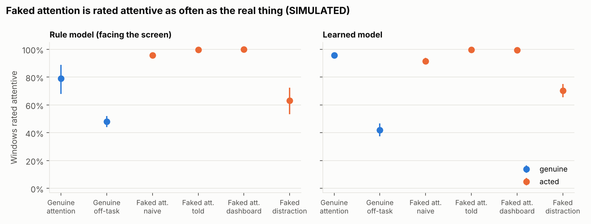
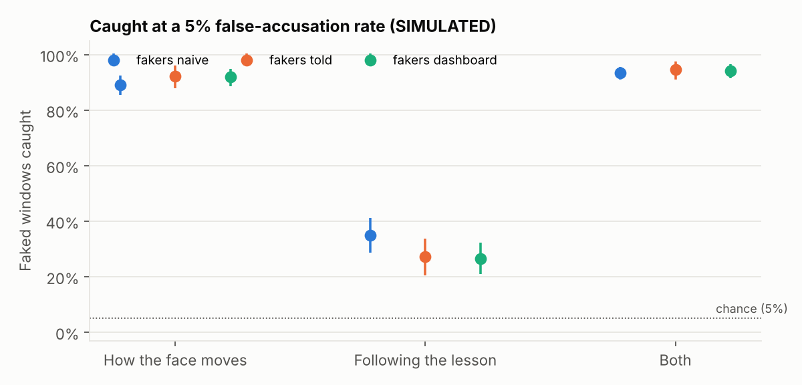
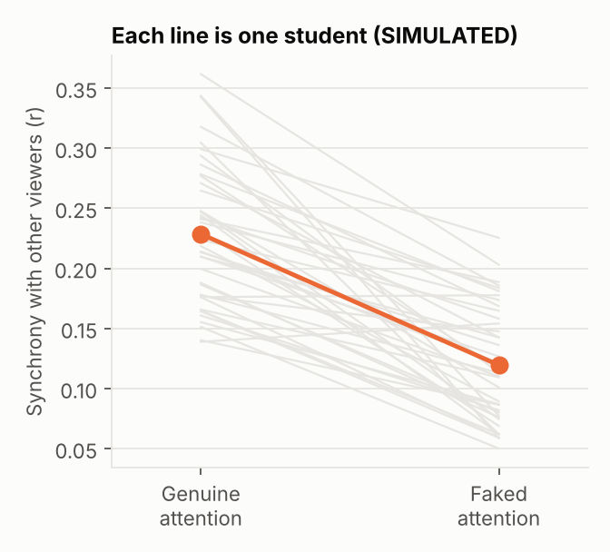
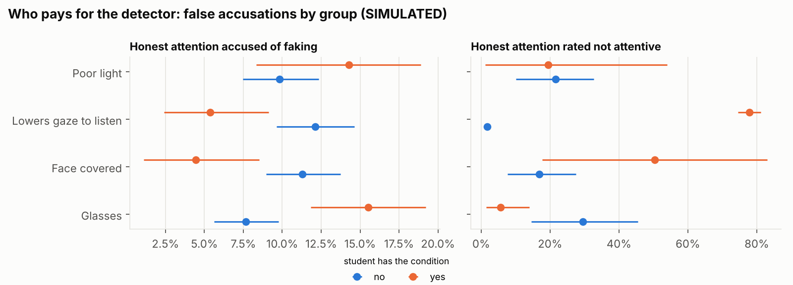

# Deceptive Gestures: can students fool classroom attention AI?

Webcam attention models assume students behave naturally. This project asks what happens when they do not: when a student **acts** attentive while thinking about something else, or acts distracted while really learning. It measures how often such acting fools attention models, whether the acting itself can be detected, and which honest students a detector then wrongly accuses.

> **Status: built and tested, not yet run with students.** Every number and figure below comes from **simulated** students whose behaviour I set by hand. They show that the pipeline works end to end. They say nothing about real students. Real data needs ethics approval first.

## Three questions

| | Question |
|---|---|
| **RQ1 Attack** | How often do faked gestures fool attention models, and does knowing what the model watches help? |
| **RQ2 Detection** | Can acting be caught from *how* the face moves, or from being out of step with the lesson and with other viewers? |
| **RQ3 Collateral harm** | Which honest students does a deception detector wrongly accuse: students with glasses, covered faces, poor light, back-row seats, or students who lower their gaze when listening? |

## Why this has not been done

Engagement detectors from the webcam are well studied, and so is telling posed from genuine facial expressions: in one study people were at chance at telling faked pain from real pain, while a computer reached 85% from the timing of the face. Gaze synchrony between viewers has been proposed as an attention signal (Madsen & Parra, PNAS 2021). In a lab test with a 250 Hz eye tracker, [Bühler et al. (ETRA 2024)](https://arxiv.org/html/2404.00333v1) found the difference small, and it did not predict learning. No study has measured students **deliberately** faking attention against these models, checked the result against what the students actually did, or asked whom a defence harms. Proctoring attacks so far are software tricks (virtual cameras, hidden windows), not acted behaviour.

## How the study works

**Ground truth never comes from the camera.** Each 3-minute part comes with an instruction, and two checks afterwards show what the student actually did:

| Condition | Instruction | What the mind is doing | Proof afterwards |
|---|---|---|---|
| A Genuine attention | Watch and learn | Following the lecture | Quiz ≥ 3 of 5 |
| B Genuine off-task | Rehearse 12 words | Rehearsing words | Recall ≥ 6 of 12 |
| C Faked attention | Rehearse 12 words **and** look as attentive as you can | Rehearsing words | Recall ≥ 6 of 12 |
| D Faked distraction | Look bored, **but** learn the content | Following the lecture | Quiz ≥ 3 of 5 |

A part counts only if its proof matches its condition.

- **Study 1, one student at a laptop (about 40 students).** Ten parts in three blocks of rising attacker knowledge: *naive* (A, B, C, D in a balanced Latin-square order), *told* (the student learns which signals the model watches), *dashboard* (the student sees the model's live attention score while acting).
- **Study 2, whole classes in front of one camera.** Every student draws a sealed card per part. Each class runs parts where 0%, 20% and 40% of the room fakes attention, to see when the room stops working as a reference.

**Models.** The *targets* are a rule model (facing the screen) and a learned model, both trained only on genuine behaviour, as a real deployment would be. The *detectors* use how the face moves (stillness, variability, onsets, blink regularity), how it follows the lesson (reaction to slide changes, synchrony with other viewers of the same video, with a lag search for player timing), or both. Study 1 scores are leave-one-student-out. Study 2 is scored by models trained on Study 1: the lab-to-classroom jump a real system would face.

**Privacy.** Each webcam frame becomes about ten numbers (head angles, gaze, eye and mouth opening, face position, brightness) and is dropped at once. No image or video is ever written to disk.

## What the code produces today (simulated students)

`python scripts/run_analysis.py --simulate` builds 40 simulated laptop students and 3 simulated classes of 24, then runs every analysis. The simulator encodes my hypotheses (fakers hold still, follow the lesson less, leak look-aways when naive), so its "findings" are built in. The figures show what the real analysis will report, not what it will find.






One property of the method showed up even in simulation and will matter with real data. The detector threshold is set so that it accuses 5% of honest windows *in the students it was trained on*. On students it has never seen, it accuses 8–12%. People differ, so a threshold tuned on some students does not hold for the next. The analysis therefore always reports the false-accusation rate measured on held-out students, never the nominal 5%.

## Install on Windows (no Python needed)

1. Download **`DeceptiveGestures-Setup-….exe`** from the [Releases page](https://github.com/Zubair-DLCS/Deceptive-Gestures/releases/latest).
2. Run it. If Windows says *"Windows protected your PC"* (the app is not code-signed), click **More info → Run anyway**. No admin rights needed.
3. Click the **Deceptive Gestures** icon on your desktop. **Try a session without the camera** works straight away.

The face model is included, so it works offline. Data and materials go to `Documents\DeceptiveGestures`: put the lecture clips in `materials\videos` and edit `materials\videos.json` before the first real session. A portable `.zip` is also on the Releases page.

## Run from source

```bash
pip install -r requirements.txt          # Python 3.10–3.14
python -m pytest -q tests                # 14 tests, about 15 s
python scripts/run_analysis.py --simulate --quick    # 1-minute smoke run
```

**Try a full session without a camera** (simulated face numbers, no videos needed):

```bash
python apps/session_app.py --dry-run --data data_dryrun        # or double-click dry_run_session.bat
```

**Study 1, real sessions.** Put ten 3-minute clips in `materials/videos/` and fill in `materials/videos.json` (slide-change times and 5 quiz questions per clip; see [materials/README.md](materials/README.md)). Then, for each student:

```bash
python apps/session_app.py               # or double-click start_session.bat
```

The first run downloads MediaPipe's face model (3.7 MB) once. Data goes to `data/study1/P###/`.

**Study 2, a whole class:**

```bash
python apps/class_app.py seats  --class class1 --session 1      # 10 s, students sit still; prints a seat map
python apps/class_app.py cards  --class class1 --session 1      # cards.html to print and hand out face down
python apps/class_app.py record --class class1 --session 1 --segment 1 --video V01   # once per part
```

Then type quiz and recall scores into `responses.csv`, and each seat's row (front, middle, back) and optional groups into `session.json`.

**Analysis of real data:**

```bash
python scripts/run_analysis.py --data data
```

## Repository layout

```
apps/session_app.py   Study 1 app: consent, camera check, 10 parts, recall and quiz (Tkinter)
apps/class_app.py     Study 2: learn seats, print sealed cards, record each part
dg/protocol.py        conditions, Latin square, word lists, class card decks
dg/sensing.py         webcam -> numbers (MediaPipe Face Landmarker); seat tracking
dg/recorder.py        recording a part; live attention score for the dashboard block
dg/features.py        10-s windows: attention, dynamics and lesson-coupling features; synchrony
dg/data.py            loads sessions, checks each part's proof, attaches groups
dg/models.py          attention models (targets) and deception detectors, out-of-person scoring
dg/analysis.py        RQ1–RQ3 with intervals bootstrapped over students; GEE test for RQ1
dg/report.py          figures
dg/simulate.py        simulated students in the recording format (hand-set assumptions)
materials/            video and quiz template, information sheet, consent form
```

## Honest limits

- **Acting on instruction is not gaming over a term.** Students told to fake for three minutes may act differently from students who learn to game a system over months. Study 2 and the dashboard block narrow the gap; they do not close it.
- **A webcam is not an eye tracker.** Gaze from a laptop camera is noisy, so synchrony uses head pose and face motion as well as gaze. At 3 m in a classroom it may not work at all; that would be a finding, not a failure.
- **The proofs can be gamed too.** A student could follow the lecture and still recall words. The thresholds are a pre-registered compromise, checked in a 5-student pilot.
- **Groups are self-reported or measured, never inferred.** Glasses, face covering and the lowered-gaze habit come from the student; poor light is measured from frame brightness. Face covering is a camera condition, never a description of a person.

## Ethics

No recording before approval from the University of Malakand ethics committee and the G.C.M.S Timergara principal. Written consent from every student, plus a parent's consent for under-18s. Taking part never affects marks. Drafts of the information sheet and consent form are in [materials/](materials/).

## Author

**Malak Zubair**, Assistant Professor of Computer Science, G.C.M.S Timergara, Higher Education Department, Khyber Pakhtunkhwa; PhD student, University of Malakand. GitHub: [Zubair-DLCS](https://github.com/Zubair-DLCS)

MIT licence.
